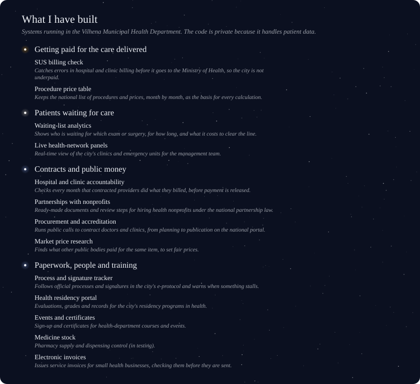
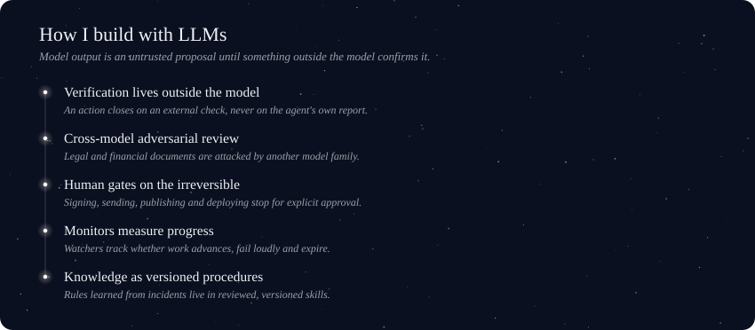
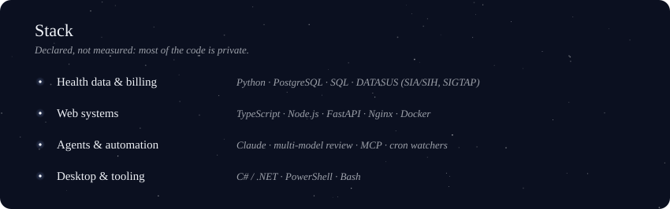

<a href="./README.pt-BR.md">🇧🇷 Versão em português</a>

  <picture>
    <source media="(max-width: 600px) and (prefers-color-scheme: light)" srcset="./assets/generated/galaxy-header-mobile-light.svg">
    <source media="(max-width: 600px)" srcset="./assets/generated/galaxy-header-mobile.svg">
    <source media="(prefers-color-scheme: light)" srcset="./assets/generated/galaxy-header-light.svg">
    
  </picture>

Physical therapist and neuroscience researcher turned builder of the systems that run a municipal public-health operation in Vilhena, Rondônia (Brazil). Executive Secretary and Director of Specialized Care at the Vilhena Municipal Health Department (SEMUS); Secretary of Health in 2022–2023. MSc in Neurological Physical Therapy (UFRN), PhD candidate at UFRN. Founder of [Mansur Consultoria](https://mansurconsultoria.com.br).

 

  

[faturamento.semusvilhena.com](https://faturamento.semusvilhena.com) · [prestacao-contas.semusvilhena.com](https://prestacao-contas.semusvilhena.com) · [sisreg.semusvilhena.com](https://sisreg.semusvilhena.com) · [processos.semusvilhena.com](https://processos.semusvilhena.com) · [painel.semusvilhena.com](https://painel.semusvilhena.com) · [residencias.semusvilhena.com](https://residencias.semusvilhena.com) · [eventos.semusvilhena.com](https://eventos.semusvilhena.com) · [nfse.mansurconsultoria.com.br](https://nfse.mansurconsultoria.com.br)

 

  

 

  

 

<strong>Open source</strong>

- [gaugely](https://github.com/kimmansur/gaugely): live usage limits and API spending for your AI tools, in the Windows taskbar.

Galaxy header generated with <a href="https://github.com/vinimlo/galaxy-profile">galaxy-profile</a> (GPL-3.0). The code of the systems is private; happy to walk through any of it.
