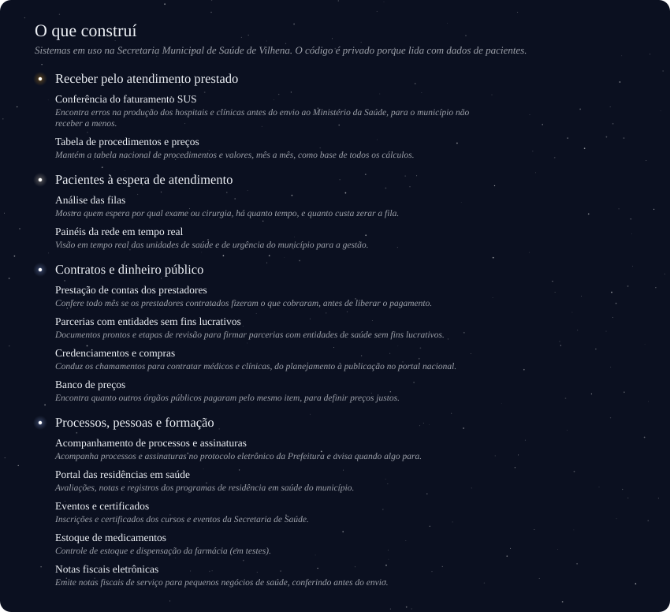
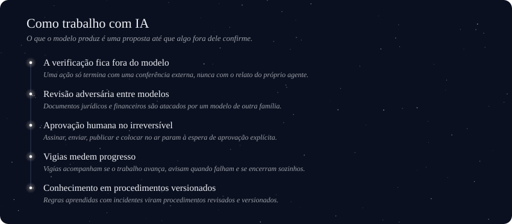
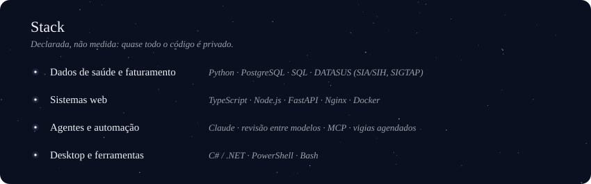

<a href="./README.md">🇺🇸 English version</a>

  <picture>
    <source media="(max-width: 600px) and (prefers-color-scheme: light)" srcset="./assets/generated/galaxy-header-mobile-light.svg">
    <source media="(max-width: 600px)" srcset="./assets/generated/galaxy-header-mobile.svg">
    <source media="(prefers-color-scheme: light)" srcset="./assets/generated/galaxy-header-light.svg">
    
  </picture>

Fisioterapeuta e pesquisador em neurociência que passou a construir os sistemas que sustentam a gestão da saúde pública municipal em Vilhena, Rondônia. Secretário Executivo e Diretor da Atenção Especializada da Secretaria Municipal de Saúde de Vilhena (SEMUS); Secretário de Saúde em 2022–2023. Mestre em Fisioterapia Neurológica (UFRN) e doutorando na UFRN. Fundador da [Mansur Consultoria](https://mansurconsultoria.com.br).

 

  

 

  

 

  

 

<strong>Código aberto</strong>

- [gaugely](https://github.com/kimmansur/gaugely): limites de uso e gastos de API das ferramentas de IA, ao vivo, na barra de tarefas do Windows.

Cada estrela brilhante do cabeçalho é um dos treze sistemas; os quatro braços são os quatro temas abaixo. Cabeçalho gerado com o <a href="https://github.com/vinimlo/galaxy-profile">galaxy-profile</a> (GPL-3.0). O código dos sistemas é privado; posso apresentar qualquer um deles.
